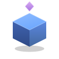

<div class="hero" markdown="1">



# Isometry

<p class="tagline">A data-driven isometric RPG framework. Build a multiplayer game by writing data, not code.</p>

<div class="cta">
<a class="primary" href="/platform/">Download</a>
<a href="/guide/">Play a campaign</a>
<a href="/manual/">Build a campaign</a>
</div>

</div>

## Write data, not code

{{ product_name }} is a single executable that loads **campaigns** defined entirely in YAML or JSON. Define maps, actors, skills, AI, items, and dialog as data, package them into a `.zip`, and the engine runs them — no programming required. Multiplayer is built in and driven from the command line, with secure, authenticated sessions.

There is no separate backend and no Docker: the game binary is the whole product. You change the game by changing the data.

## What you get

- **Isometric grid worlds** — tile maps with layers, terrain, spawns, fog of war, and pathfinding.
- **Data-defined actors & AI** — stats, resources, skills, and goal-driven strategies, all as entities.
- **{{ action_count }} built-in action functions** — damage, healing, movement, teleport, spawn, dialog, and more, composed from data.
- **Multiplayer first** — host, dedicated server, or client over the network; single-player is just a one-client session.
- **Gamepad + keyboard** with remappable keybinds, and themeable UI.
- **{{ entity_count }} entity types** — a small, composable vocabulary that describes a whole game.

## A campaign is just data

The required entry point names the starting map, and optionally a starting actor:

```yaml
Main:
  demoMain:
    actor: heroActor
    map: demoMap
```

Entities reference each other by key, and the engine validates every reference before a campaign is allowed to run.

## Where to next

- **[Download &amp; install](/platform/)** — get the engine for Linux, Windows, or macOS.
- **[Player Guide](/guide/)** — install, join, host, and play campaigns.
- **[Developer Manual](/manual/)** — build a campaign from scratch, end to end.
- **[Reference](/reference/)** — every entity, action function, and CLI flag.
- **[Recipes](/recipes/)** — reusable patterns for plugins and campaigns.
- **[Updates](/updates/)** — what's new (currently in open beta, v{{ version }}).

<p style="color:var(--fg-dim)">Isometry is made by {{ publisher }} and licensed {{ license }}.</p>
